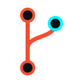
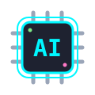
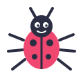

  

  
  
  

  
  
  
  
  

  
  
  

  
  
  

---

## About Me

- Computer Science undergraduate at **SLIIT**
- Building **AI-powered backends**, **RAG pipelines** and **distributed components**
- Into **microservices, systems-level engineering and clean architecture**
- Contributing to **open-source projects**

---

## Tech Stack

   
  

  
  
  
  
  

---

## Connect

  
  
  

